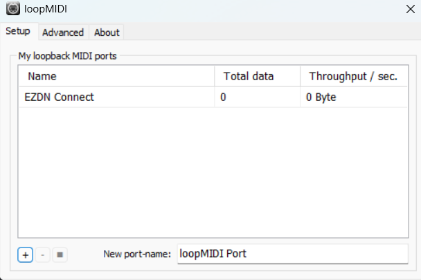
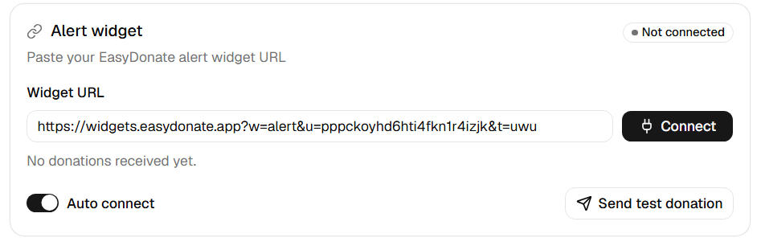
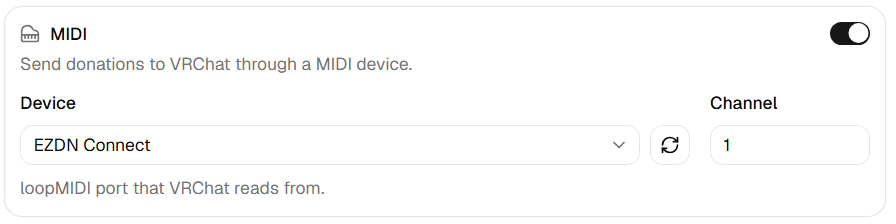
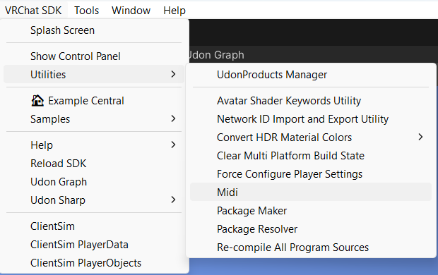
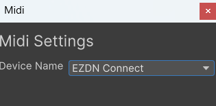
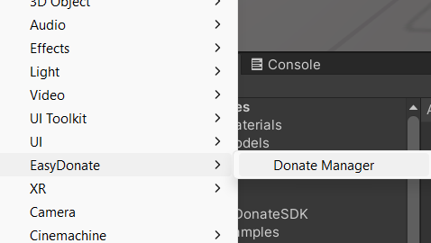
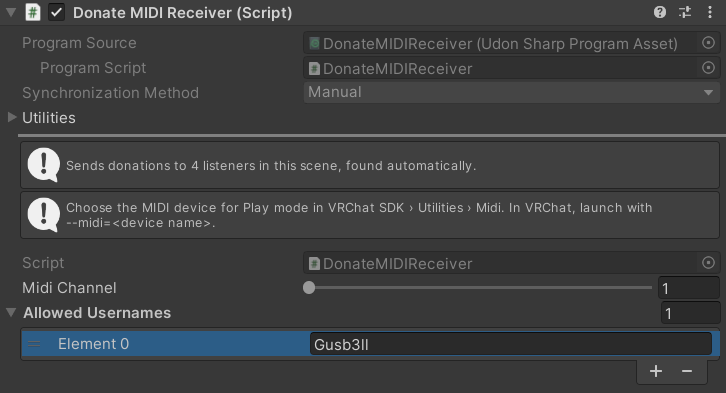
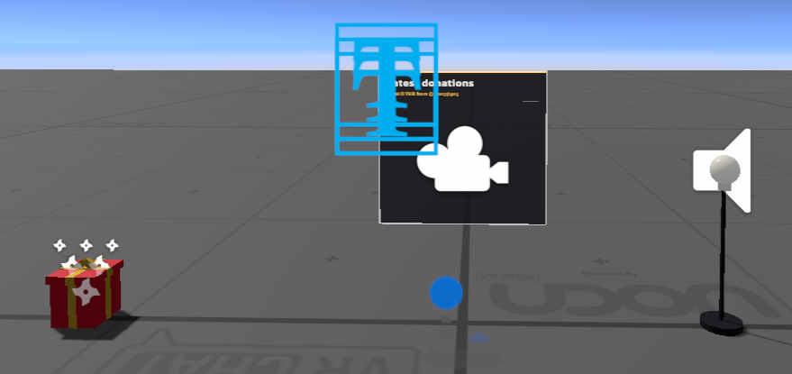

# VRChat


Donation data is sent via MIDI over the desktop app

```text
Alert widget
        │
        ▼
EasyDonate Connect
        │ MIDI through a loopMIDI port
        ▼
VRChat client launched with --midi (streamer)
        │ Udon sync
        ▼
World Instance
```

## Requirements

- [loopMIDI](https://www.tobias-erichsen.de/software/loopmidi.html), required to create virtual midi device
- [EasyDonate](https://easydonate.app) account
- For world creators: Unity 2022.3 and VRChat SDK Worlds 3.10.5 or later

## Installation

1. Install [loopMIDI](https://www.tobias-erichsen.de/software/loopmidi.html)
2. Install the [latest release](https://github.com/easydonate-th/connect/releases) of the desktop app
3. Add port on the loopMIDI application



4. Open https://easydonate-th.github.io/connect/ and click **Add to VCC**. Or, in VCC or ALCOM, go to **Settings > Packages > Add Repository** and add `https://easydonate-th.github.io/connect/index.json`
5. Open your world project with **Manage Project** and add **EasyDonateSDK**.

## Usage

### Connecting to EasyDonate

1. Get the **Alert Widget URL** from the [dashboard](https://easydonate.app/dashboard) and paste it into **Alert Widget URL** in the desktop app



2. Click **Connect**. The app will show **Connected** when the connection is successful, else it will show an error message

### Send donations to VRChat over MIDI

1. Make sure loopMIDI is running and has your port.
2. In **Integrations**, open **VRChat** and turn on **MIDI**.
3. Pick your loopMIDI port in **Device**. If you created the port after opening the app, click the refresh button to scan again.
4. Set **Channel** (1-16). The world's Donate Manager must use the same channel.



5. Click **Save**. Donations go only to the outputs turned on in the saved settings.
6. Launch VRChat with `--midi=<loopMIDI port name>`, for example `--midi=EasyDonate` in Steam's launch options.
7. Join a world that uses the EasyDonate SDK and either lists your VRChat display name in **Allowed Usernames** or leaves that list empty.

### Set up a world

1. On the top navigation, choose VRChat SDK > Utilities > Midi and set your midi device that matches the desktop app





2. Choose **GameObject > EasyDonate > Donate Manager**

 EasyDonate > Donate Manager menu" width="360" />

3. On `DonateManager`, set **Midi Channel** to the channel used in the desktop app, and add the allowed VRChat username to **Allowed Usernames**.



4. Add **Donate Trigger** components to other objects for the effects you want. Each trigger has a **Min Amount** and **Max Amount** in THB, and can turn on objects, set an Animator trigger, play a sound or send a custom event to an UdonBehaviour. Keep triggers off `DonateManager` itself.

> The receiver automatically syncs the donation history and totals to all players in the world.

Example prefabs come with the SDK, in the `Examples` folder under **Packages > EasyDonateSDK** in the Project window.



### Test

1. Pick your MIDI port in **VRChat SDK > Utilities > Midi** before entering Play mode.
2. Turn on ClientSim
3. Enter Play mode and click **Send test donation** in the desktop app or test widget button in the dashboard

### Testing world

[EasyDonateSDK Testing World](https://vrchat.com/home/world/wrld_bd94961b-b8bf-41ac-965b-fe8c878ea394)

Make sure you have the loopMIDI running with port named "EZDN Connect" and the desktop app point to it at channel 1

# OSC

The **OSC** output sends each donation over UDP to **Host** and **Port** (default `127.0.0.1:9000`) as four messages:

| Address           | Value                     |
| ----------------- | ------------------------- |
| `/ezdn/reference` | Donation reference number |
| `/ezdn/name`      | Donor name                |
| `/ezdn/message`   | Donation message          |
| `/ezdn/amount`    | Amount in THB             |
