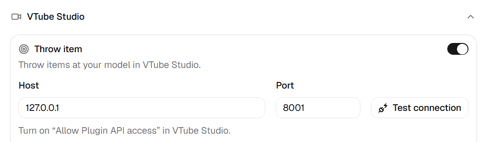
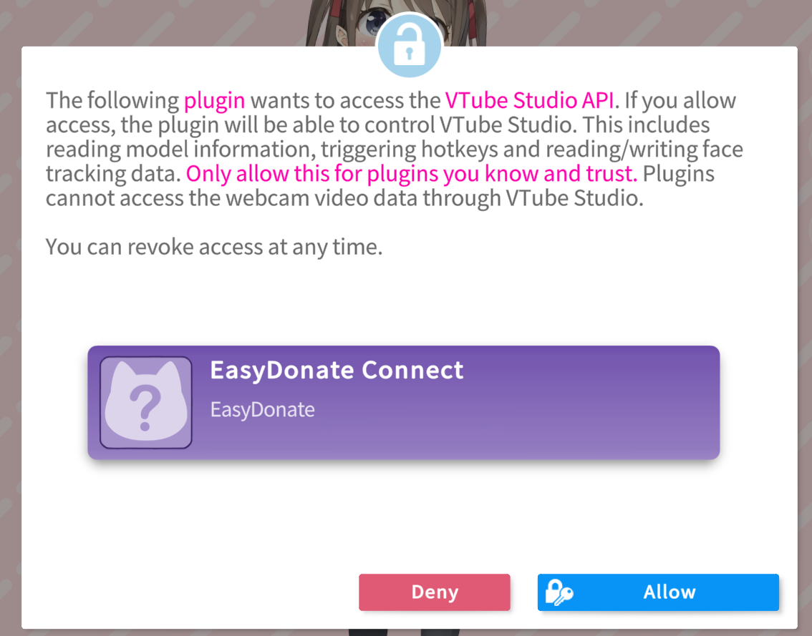

# VTube Studio

## Requirements

- [VTube Studio](https://denchisoft.com/) installed
- [EasyDonate](https://easydonate.app) account

## Installation

1. Install the [latest release](https://github.com/easydonate-th/connect/releases) of the desktop app
2. Enable the Plugin API in VTube Studio

3. Open the desktop app, Go to **Integrations > VTube Studio** and click **Connect** test connection. The VTube Studio will pop up a prompt to allow the plugin. Click **Allow**

4. Choose or upload image and test it with, **Send Test Donation**
